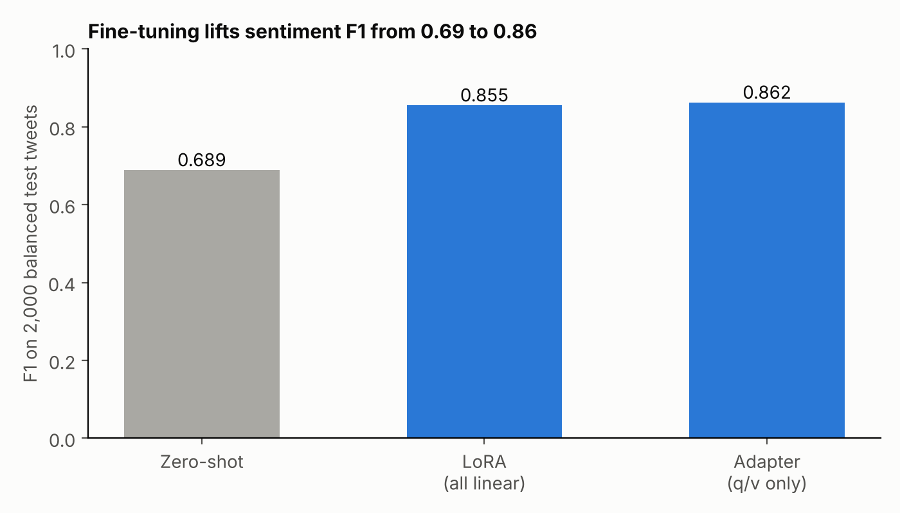
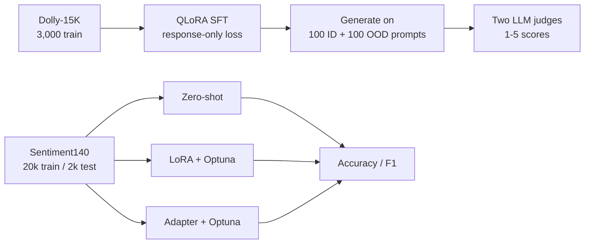

# Instruction tuning and parameter-efficient fine-tuning of Gemma 2B

Coursework for DATA 266 (Generative AI) at San José State University, Spring 2026. Two experiments on Gemma-2-2B with 4-bit quantization:

1. **Instruction tuning** with QLoRA on Dolly-15K, checked on in-distribution (Dolly) and out-of-distribution (Alpaca) prompts with LLM judges.
2. **Sentiment classification** on Sentiment140 comparing zero-shot, LoRA and a narrow adapter, each tuned with Optuna.



## Part II: sentiment classification (the clearer result)

20,000 balanced training tweets, 2,000 balanced test tweets sampled from 1.55M cleaned tweets, no text overlap between them.

| Method | Accuracy | Precision | Recall | F1 | Best hyperparameters |
|---|---|---|---|---|---|
| Gemma-2-2b zero-shot | 0.7135 | 0.7539 | 0.6340 | 0.6888 | n/a |
| LoRA, all linear layers (10 Optuna trials) | 0.8570 | 0.8665 | 0.8440 | 0.8551 | r=32, alpha=32, lr 1.10e-4, dropout 0.087 |
| Narrow adapter, q/v only (7 Optuna trials) | 0.8620 | 0.8606 | 0.8640 | **0.8623** | rank 16, alpha 32, lr 1.29e-4, dropout 0.031 |

Fine-tuning adds about 17 F1 points over zero-shot. The 0.007 gap between LoRA and the adapter is not meaningful: with 2,000 test tweets one standard error on accuracy is about 0.8 points. The course's 90% bonus threshold was not reached.

## Part I: instruction tuning (inconclusive comparison)

Gemma-2-2b-it, QLoRA (rank 16, alpha 32, 20.8M trainable of 2.64B parameters, 0.79%), 3 epochs on 3,000 Dolly-15K examples with the loss computed on the response only. Responses were generated for 100 held-out Dolly prompts and 100 Alpaca prompts and scored 1 to 5 by two LLM judges from different providers (an Anthropic model and GPT-5.4).

| Set | Arm | Instruction following | Helpfulness | Fluency | Average |
|---|---|---|---|---|---|
| ID (Dolly) | base | 2.59 | 2.24 | 2.26 | 2.363 |
| ID (Dolly) | fine-tuned | 2.57 | 2.25 | 2.28 | 2.367 |
| OOD (Alpaca) | base | 2.34 | 2.15 | 2.13 | 2.207 |
| OOD (Alpaca) | fine-tuned | 2.34 | 2.10 | 2.15 | 2.197 |

The cross-check judge scored only the fine-tuned responses (ID 2.82, OOD 2.68), so there is no second-judge base-versus-tuned comparison.

**How to read this honestly:** the base and fine-tuned arms are statistically indistinguishable (a 0.004 difference on a 1 to 5 scale). In the notebook, the printed example responses for the two arms are nearly identical text, and the "base" generations were produced from the same model object that `get_peft_model` had modified in place when the adapter was attached. So the "base" arm very likely already carried the trained adapter, and this comparison does not measure what it says. The scripts here reload a clean base model before generating. A rerun is needed before claiming any instruction-tuning effect. The notebook's own summary said the fine-tuned model "IMPROVED"; I don't make that claim.

## Other caveats

- Optuna trials and best-checkpoint selection for Part II use the same 2,000 test tweets that produce the reported numbers, so all fine-tuned scores are slightly optimistic. A separate validation split is the fix.
- The "adapter" in Part II is a LoRA configuration on `q_proj` and `v_proj` only, not a bottleneck adapter module.
- Judge responses were truncated to 400 characters and generation was capped at 80 new tokens, which depresses all scores. In the original notebook, a judge parse failure was silently scored 3; `src/judge.py` records a missing score instead.
- Model outputs and the full per-response judge tables are not included here.

## Pipeline



## Run it

```bash
pip install transformers==4.51.3 trl==0.8.6 peft bitsandbytes datasets accelerate optuna scikit-learn pandas matplotlib anthropic openai
export HF_TOKEN=...            # Gemma is gated on Hugging Face
export ANTHROPIC_API_KEY=... OPENAI_API_KEY=...   # only for src/judge.py
cd src
python part1_instruction_tuning.py
python judge.py
python part2_peft_sentiment.py   # needs training.1600000.processed.noemoticon.csv from Sentiment140
python ../make_chart.py
```

The original runs used one A100 40 GB GPU in Colab.

## Files

| File | Purpose |
|---|---|
| `src/common.py` | Seeds, 4-bit NF4 config, token from environment |
| `src/part1_instruction_tuning.py` | Dolly SFT and ID/OOD generation |
| `src/judge.py` | Two-provider LLM-as-judge scoring |
| `src/part2_peft_sentiment.py` | Sentiment140 split, zero-shot, LoRA and adapter with Optuna |
| `results/` | Metrics copied from the notebook output |

The code was rebuilt from my course notebook, with API keys moved to environment variables.

Author: Vrushabh Bodarya

`PyTorch` `Transformers` `PEFT` `TRL` `Optuna` `QLoRA`
